# Doctor Tracker

Doctor Tracker is an internal admin portal for a group of Dhaka hospitals. An administrator signs in with a password or an approved Google account. From there they can:

- manage the doctors on staff
- record and edit patient admissions under each doctor, and move or unassign patients between doctors
- see admissions, workload and patient condition over any date range on a dashboard

It's two separate applications, a Next.js web client and an Express REST API, sharing one set of Zod schemas in a Turborepo monorepo, backed by MongoDB. The seed data is 50 doctors and 5,000 patients over twelve months, so search, pagination, indexes and charts all have real volume to work against.

**Demo login:** `admin@example.com` / `DemoAdmin#2026`

## Contents

- [Setup guide](#setup-guide)
- [System architecture](#system-architecture)
- [Technical decisions](#technical-decisions)
- [Visual evidence](#visual-evidence)
- [What I'd do next](#what-id-do-next)

## Setup guide

### With Docker (recommended)

```bash
docker compose up --build
```

That's the only command. Compose runs the services in this order:

1. starts MongoDB (named volume, healthcheck)
2. runs a one-off `seed` job once Mongo is healthy
3. starts the API only after the seed has completed
4. starts the web app once the API's `/health` passes

Then open http://localhost:3000 and sign in with the demo account above.

| Service | URL                                        | Notes                                                                       |
| ------- | ------------------------------------------ | --------------------------------------------------------------------------- |
| Web     | http://localhost:3000                      | The only thing a browser needs.                                             |
| API     | http://localhost:4000                      | Bound to localhost. The browser reaches it through the web app (see below). |
| MongoDB | `mongodb://localhost:27017/doctor-tracker` | Bound to localhost, for `mongosh`.                                          |

Every setting has a working default. To change one (ports, secrets, Google), copy `.env.example` to `.env` next to `docker-compose.yml` and edit it.

The seed is idempotent. It skips if doctors already exist, so restarting the stack keeps your data. To start over:

```bash
docker compose run --rm seed node dist/scripts/seed.js --reset
```

### Locally, without Docker for the apps

You need Node 24+, pnpm 11 (`corepack enable` on Node 24 picks the pinned version; Node 25+ dropped corepack, so use `npm i -g pnpm@11` there), and a MongoDB. The quickest Mongo is the one from compose:

```bash
docker compose up -d mongo
cp apps/api/.env.example apps/api/.env      # set JWT_ACCESS_SECRET to 32+ random characters
cp apps/web/.env.example apps/web/.env
pnpm install
pnpm seed                                   # pnpm --filter api seed --reset to wipe and reseed
pnpm dev                                    # web on :3000, api on :4000, shared rebuilds on change
```

Other root scripts all run through Turborepo:

```bash
pnpm build | pnpm lint | pnpm typecheck | pnpm test | pnpm format:check
pnpm --filter api explain                   # query-plan check, see "Indexing" below
pnpm --filter web screenshots               # recaptures docs/screenshots from a running app
```

`pnpm test` runs the API integration tests against an in-memory MongoDB (`mongodb-memory-server`), so it needs no running database.

### Optional: Google sign-in

The "Continue with Google" button only appears when the API has Google credentials. Without them, everything else works.

1. In Google Cloud Console, create an OAuth client of type **Web application**.
2. Add the authorized redirect URI `http://localhost:3000/api/v1/auth/google/callback`. It points at the web origin, not the API (explained below).
3. Set these in `.env` (compose) or `apps/api/.env` (local):
   ```
   GOOGLE_CLIENT_ID=...
   GOOGLE_CLIENT_SECRET=...
   ADMIN_EMAILS=you@yourdomain.com
   ```
4. Restart the API (`docker compose up -d api`).

Who can sign in with Google:

- an existing user with that verified email (Google gets linked to the account)
- an address in `ADMIN_EMAILS` (an admin is created)

Any other Google account sees a "not authorized" screen.

## System architecture

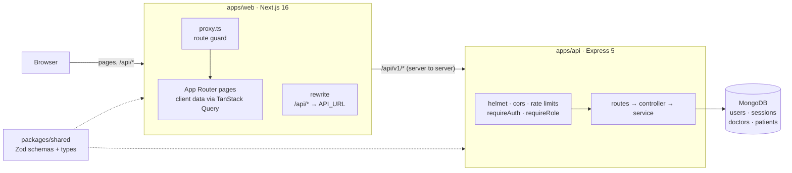

The browser only ever talks to the web origin. Pages render in Next.js. Anything under `/api/*` is rewritten by the Next server to the Express API, which validates every request with the same Zod schemas the forms use (`packages/shared`). Express owns all data and all authorization. The web app holds no data and only does UX-level redirects.

The API is layered as routes → controller → service → Mongoose model. Controllers have no try/catch: Express 5 forwards rejected promises to one central error handler, which turns everything into `{ error: { code, message, details } }`. Lists return `{ data, meta: { page, limit, total, totalPages } }`.

### Auth flow

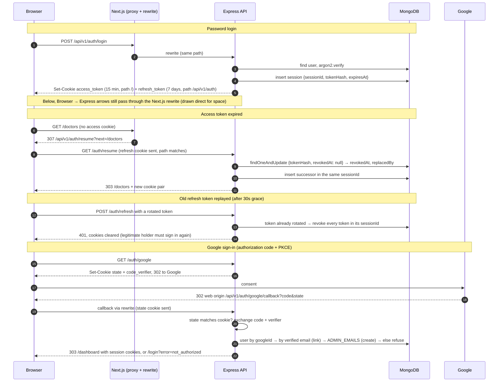

### Repository layout

```
apps/api            Express API: modules/{auth,users,doctors,patients,stats}, scripts/{seed,explain}
apps/web            Next.js app: app/ routes, features/{auth,doctors,patients,dashboard}, components/{ui,data-table,shared,layout}
packages/shared     Zod schemas, constants and response types used by both apps
packages/config     tsconfig bases, ESLint flat configs, Prettier config
```

Each Docker image is built from `turbo prune <app> --docker`, so it only installs what that app depends on. The API ships `pnpm deploy --prod` output and the web ships Next's standalone server. Both run as the non-root `node` user.

## Technical decisions

### 1. Auth cookies across a separate Next.js client and Express API

The web app and the API are separate applications on separate origins. The usual options for auth between them each have a real cost:

- **Tokens in `localStorage` and an `Authorization` header.** Any script on the page can read them, so one XSS bug becomes stolen sessions that work from anywhere.
- **Cross-origin cookies** (`SameSite=None; Secure` plus CORS with credentials). This works today, but browsers increasingly block third-party cookies (Safari already does), and every request pays for a CORS preflight.

I avoided both by never letting the browser talk to the API's origin. `next.config.ts` rewrites `/api/:path*` to `API_URL`, so the Next server proxies API calls server to server. From the browser's point of view, `/api/v1/auth/login` is the same origin as the page. The cookies the API sets come back through the proxy as **first-party** cookies on the web domain, so they can be `HttpOnly` and `SameSite=Lax`. The Google redirect URI points at the web origin for the same reason: the callback's cookies are first-party too.

The cookies:

| Cookie                               | Content                                              | Lifetime | Path                  | Why                                                                  |
| ------------------------------------ | ---------------------------------------------------- | -------- | --------------------- | -------------------------------------------------------------------- |
| `access_token`                       | HS256 JWT (`sub`, `role`, `sid`), signed with `jose` | 15 min   | `/`                   | Stateless: verifying it needs no database read.                      |
| `refresh_token`                      | 256 random bits; only its SHA-256 is stored          | 7 days   | `/api/v1/auth`        | Only sent to auth routes, never on ordinary API calls or page loads. |
| `oauth_state`, `oauth_code_verifier` | Google CSRF state and PKCE verifier                  | 10 min   | `/api/v1/auth/google` | Read and cleared by the callback.                                    |

CSRF is covered three ways:

- `SameSite=Lax`, so cross-site POSTs carry no cookie
- JSON-only endpoints, which a cross-site form can't send without a preflight
- CORS locked to `WEB_ORIGIN` (the browser never needs CORS here, so that's defense in depth)

`trust proxy` is set to one hop, so rate limiting and logs see the real client IP behind a load balancer.

**Session continuity:**

- **On navigation:** the refresh cookie is scoped to `/api/v1/auth`, so `proxy.ts` (Next's route guard) can't see it. When the access cookie has expired, the proxy redirects to `/api/v1/auth/resume?next=…`. The browser sends the refresh cookie there, the API rotates it and redirects straight back, and the page never renders logged out.
- **During client requests:** a 401 triggers one shared refresh (all concurrent requests wait on the same promise) and a single retry.

**Tradeoffs I accepted:**

- **An extra hop.** Every API call goes browser → Next → Express. It's negligible next to database time, but the Next server is in the request path. In production I'd put both behind one load balancer with path routing (`/api/*` → API), which keeps the same-origin property without the hop.
- **`API_URL` is baked in at build time.** Next serializes rewrites into the standalone server during `next build`. It's a Docker build arg, and it's declared in turbo's `env` for `web#build` so a cached build can't point at the wrong API.
- **The route guard is optimistic.** `proxy.ts` only checks that the access cookie exists (its `maxAge` equals the JWT lifetime). It doesn't verify the signature, which would mean sharing the secret with the web app. That's safe because the web app renders no data server-side: a forged cookie gets an empty shell whose first API call is a 401. Express verifies every request.
- **Stateless access tokens.** After logout or a revoked session, an already issued access token keeps working until it expires, up to 15 minutes. At scale I'd shorten the TTL or check `sid` against a small revocation set in Redis.

### 2. Indexing and aggregation, verified with explain()

Every index exists for a specific query, and `pnpm --filter api explain` proves it. The script runs the **services' own query builders** (not hand-copied queries) through `explain('executionStats')`. It fails on any COLLSCAN or in-memory SORT, and on any document fetch in a query marked as covered.

**Patients**

| Index                                          | Serves                                                                                                                                   |
| ---------------------------------------------- | ---------------------------------------------------------------------------------------------------------------------------------------- |
| `{ admittedAt: -1, _id: -1 }`                  | default list (newest admission first), admitted-date range                                                                               |
| `{ condition: 1, admittedAt: -1, _id: -1 }`    | condition filter with the default sort and range (equality, then sort, then range)                                                       |
| `{ doctorId: 1, admittedAt: -1, _id: -1 }`     | a doctor's patients, the "unassigned" filter (`doctorId: null` is stored explicitly), per-doctor patient counts, the delete-doctor guard |
| `{ name: 1, _id: 1 }` (collation en/2)         | case-insensitive name sort, both directions                                                                                              |
| `{ admittedAt: 1, condition: 1, doctorId: 1 }` | the dashboard aggregation, covered                                                                                                       |
| `{ searchTokens: 1 }`                          | search                                                                                                                                   |

**Doctors**

| Index                                           | Serves                                                    |
| ----------------------------------------------- | --------------------------------------------------------- |
| `{ createdAt: -1, _id: -1 }`                    | default list, created-date range                          |
| `{ specialization: 1, createdAt: -1, _id: -1 }` | specialization filter; `distinct` for the filter options  |
| `{ hospital: 1, createdAt: -1, _id: -1 }`       | hospital filter; `distinct`                               |
| `{ name: 1, _id: 1 }` (collation en/2)          | name sort                                                 |
| `{ email: 1 }` unique                           | duplicate-email check (returned as `409 DUPLICATE_EMAIL`) |
| `{ searchTokens: 1 }`                           | search                                                    |

The other collections index only what they look up:

- **users:** unique `email`, and a partial unique `googleId`
- **sessions:** unique `tokenHash`, plus `sessionId` (revoke a whole family) and a TTL index on `expiresAt`, so Mongo deletes expired refresh tokens itself

Results on the seed data (50 doctors, 5,000 patients):

| Query                                         | Winning plan                                                       | Keys  | Docs  | Returned |
| --------------------------------------------- | ------------------------------------------------------------------ | ----- | ----- | -------- |
| doctors, default list                         | `IXSCAN(createdAt_-1__id_-1)`                                      | 20    | 20    | 20       |
| doctors, name Z–A                             | `IXSCAN(name_1__id_1)` walked backwards                            | 20    | 20    | 20       |
| doctors, 2 specializations                    | `SORT_MERGE[IXSCAN × 2]`                                           | 6     | 6     | 6        |
| doctors, hospital + created range             | `IXSCAN(hospital_1_createdAt_-1__id_-1)`                           | 2     | 2     | 2        |
| patient counts for a page of doctors          | `GROUP > PROJECTION_COVERED > IXSCAN(doctorId…)`                   | 1,766 | **0** | 20       |
| patients, default list                        | `IXSCAN(admittedAt_-1__id_-1)`                                     | 20    | 20    | 20       |
| patients, critical                            | `IXSCAN(condition_1_admittedAt_-1__id_-1)`                         | 20    | 20    | 20       |
| patients, critical + recovering, last 90 days | `IXSCAN(admittedAt_-1__id_-1)` + filter                            | 39    | 39    | 20       |
| patients, one doctor / unassigned             | `IXSCAN(doctorId_1_admittedAt_-1__id_-1)`                          | 20    | 20    | 20       |
| patients, search "rah"                        | `SORT > FETCH > IXSCAN(searchTokens_1)`                            | 148   | 147   | 20       |
| dashboard, last 90 days                       | `PROJECTION_COVERED > IXSCAN(admittedAt_1_condition_1_doctorId_1)` | 1,706 | **0** | 1,706    |
| dashboard, last 12 months                     | same                                                               | 5,000 | **0** | 5,000    |

What's behind those numbers:

- **Search uses tokens, not `$text` or a case-insensitive regex.** `$text` matches whole stemmed words, so "rah" never finds "Rahman". A `/rah/i` regex can't use index bounds. Instead each document stores `searchTokens`: lowercased name words, the email, and phone digits (including the local `01…` form of `+880` numbers). A search is an anchored, case-sensitive prefix regex on those tokens, which is a tight index range. The tokens are rebuilt in a `pre('validate')` hook, so updates go through `doc.set()` + `save()`; `findOneAndUpdate` would skip the hook.
- **The one in-memory sort is search, and it's allowed on purpose.** A prefix match is a range scan, and an index can't return those matches in date order (the equality-sort-range rule). Only the matches get sorted, and with a limit Mongo keeps a top-20 heap instead of sorting all of them. At scale this is the query I'd move to Atlas Search.
- **Every list sort ends in `_id`, and so does every list index.** Skip/limit paging over a non-unique key (two doctors named "Ayesha Akter") can repeat or skip rows between pages. The `_id` tiebreaker makes the order total, and because it's in the index, there's still no SORT stage. A test pins this down.
- **The dashboard is one aggregation.** `$match` on the admitted range is the only stage that can use an index. `$project` keeps the three fields every widget reads, which makes the scan covered: 0 documents fetched. One `$facet` then fans that slice into the total, the condition counts, admissions over time, the top 10 doctors and the unassigned count. Days are bucketed in Asia/Dhaka time with `$dateTrunc` (weeks start on Sunday, the local working week), empty days are filled with zero, and doctor names are joined with `$lookup` only after `$limit 10`. The previous-period count and the totals (`estimatedDocumentCount`, read from metadata) run in parallel with it. The endpoint answers in about 15 ms on the seed data.
- **List count and page run concurrently** (`Promise.all`). Doctor names for a page of patients come from one `$in` query, not one per row.

**What I'd change at scale:**

- skip/limit costs O(page × size), so I'd move to keyset pagination (`?after=<createdAt,_id>`)
- the covered dashboard scan is still linear in the range, so I'd pre-aggregate daily counts per doctor and condition
- search would move to Atlas Search

### 3. Shorter notes

**Refresh token rotation with reuse detection.** Every refresh token works once. Using it issues a successor in the same `sessionId` family. If an old token is presented again, someone has a copy, and the server can't tell the thief from the user. So it revokes the whole family and both have to sign in again (the OAuth 2.0 security BCP approach).

Two details make this hold up in practice:

- **Atomic claim.** The old token is claimed with one conditional `findOneAndUpdate({ tokenHash, revokedAt: null })` that sets `revokedAt` and the successor's id _in the same write_. Two concurrent refreshes can never both succeed, and a concurrent reader never sees "revoked but not replaced".
- **30-second grace window.** A token rotated less than 30s ago gets a 401 _without_ revoking anything. Without it, two tabs (or the route guard and a client query) refreshing at the same moment would log the user out. The cost: a replay inside that window isn't detected, though it isn't granted anything either.

**Google sign-in is allowlisted.** Google proves who someone is, not that they should be an admin. Linking an existing account by email requires `email_verified`, and it's refused if the account is already linked to a different Google id. Otherwise anyone could create a Google account with your address and take over your admin login. State and PKCE use arctic's helpers; the session logic is my own. The ID token's claims are decoded but not signature-verified, which OIDC allows because the token comes straight from Google's token endpoint over TLS. `iss`, `aud` and `exp` are still checked.

**Deleting a doctor is blocked while patients are assigned.** The API returns `409 DOCTOR_HAS_PATIENTS` with the count, and the dialog says it before the click. Patients are never deleted with a doctor: in a clinic that would be data loss, so they have to be reassigned or unassigned first. There's a small check-then-delete race. Closing it needs a transaction, and therefore a replica set; I didn't add one for a single-admin tool. A patient left pointing at a deleted doctor shows as unassigned.

**Rate limits.** Login allows 10 _failed_ attempts per 15 minutes per IP and email; refresh allows 100 per 15 minutes per IP. The store is in memory, which is correct for one API instance. With several instances I'd use Redis.

**Tests.** `pnpm test` runs 36 API integration tests (Vitest + supertest + mongodb-memory-server). They cover:

- **auth:** login and failure, identical answers for wrong password and unknown email, refresh rotation, reuse after the grace window revoking the family, logout, protected routes, and Google callbacks with only the network exchange mocked (not allowlisted, linking, allowlisted, unverified email, forged state)
- **doctors:** pagination, stable paging with equal sort keys, filters, the duplicate email, the blocked delete
- **patients:** CRUD including unassign, and the filters
- **stats:** dashboard totals

CI (GitHub Actions) runs `turbo run lint typecheck test build` with the turbo and pnpm caches restored, plus a job that builds both Docker images.

## Visual evidence

Desktop screenshots are 1440 px wide and mobile ones 390 px. They're captured by `pnpm --filter web screenshots` from the production build.

|                                                                                              |                                                                                            |
| -------------------------------------------------------------------------------------------- | ------------------------------------------------------------------------------------------ |
| **Dashboard** 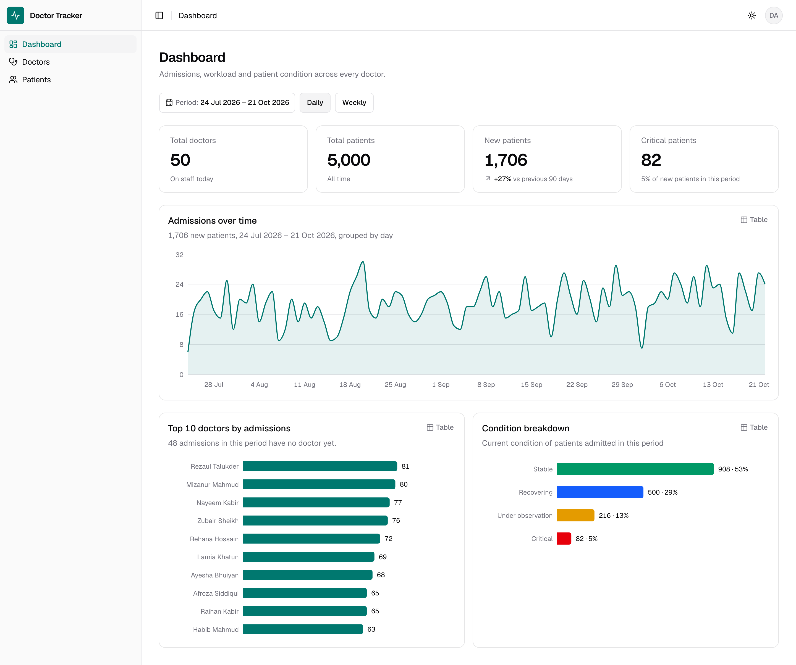                           | **Dashboard, dark** 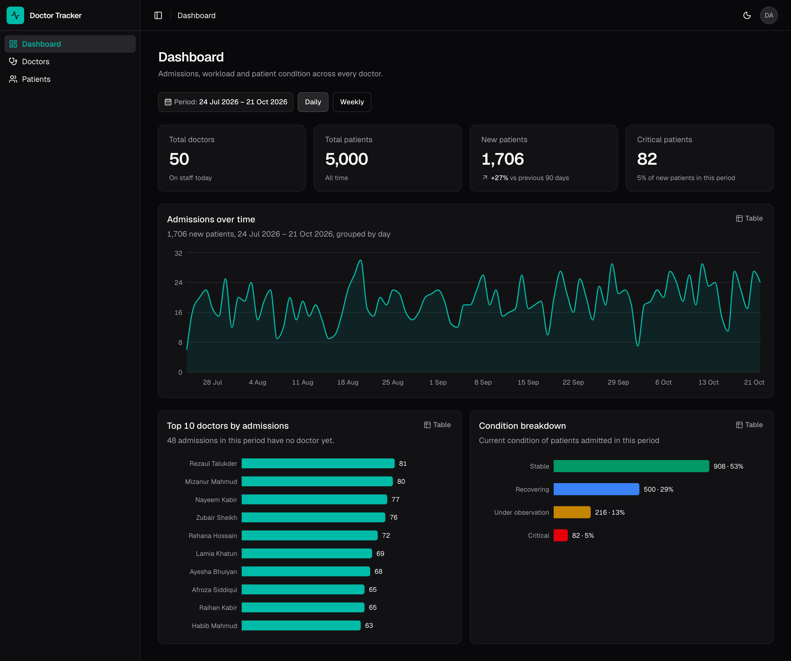 |
| **Doctors** 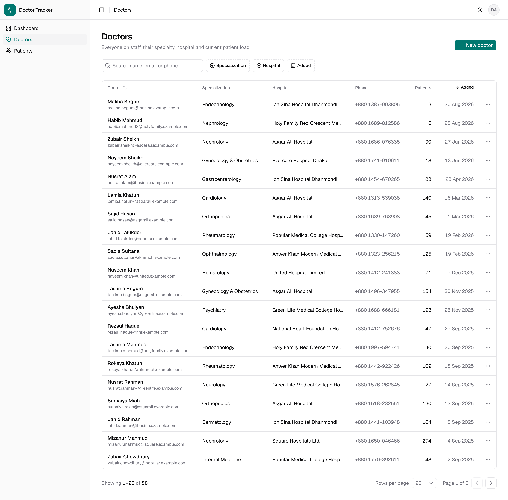                            | **Doctors, dark** 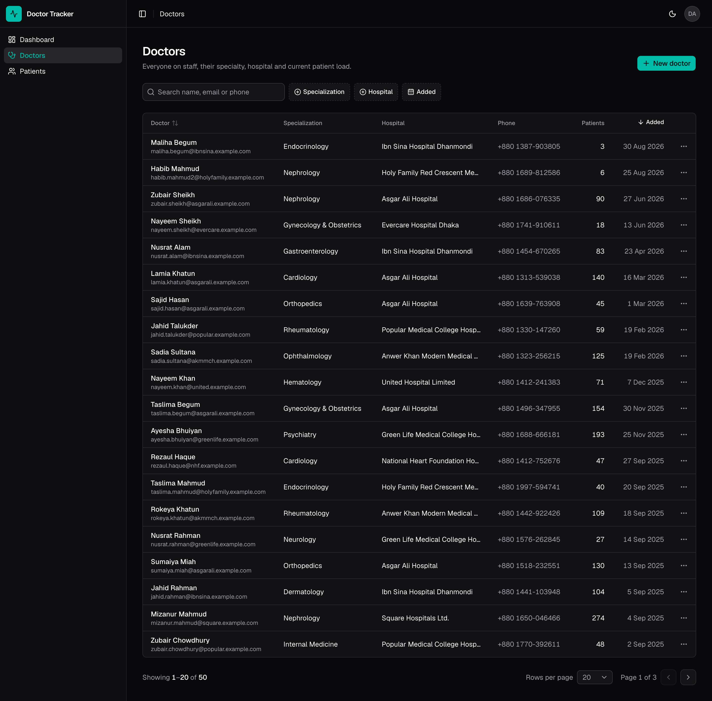  |
| **Doctor detail** 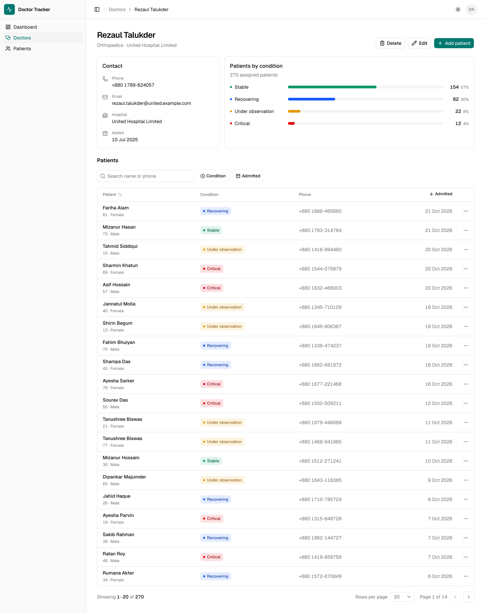 | **Patients** 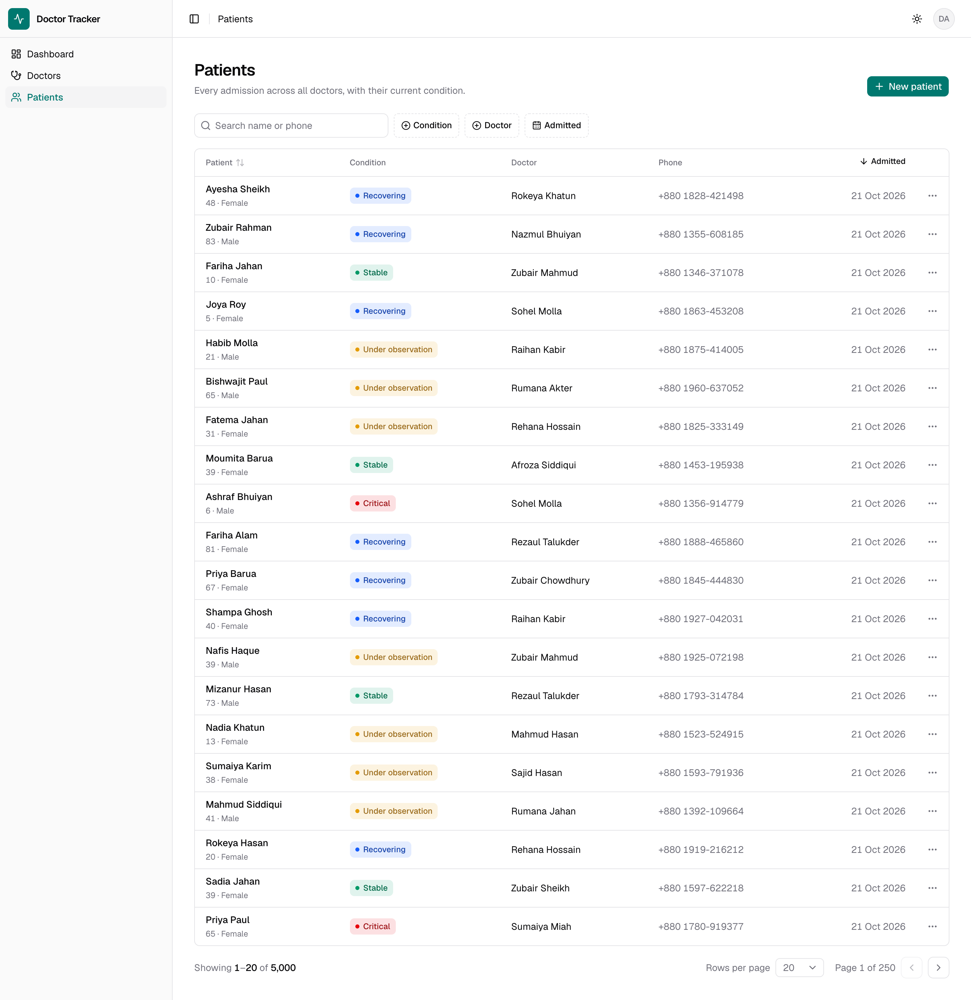                       |
| **Sign in** 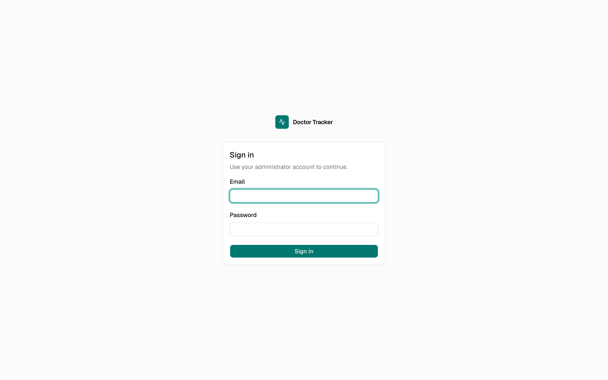                                   |                                                                                            |

On mobile, tables become stacked cards, filters move into a bottom sheet, and the sidebar becomes a drawer.

| Dashboard                                                  | Doctors                                                | Doctor detail                                                      | Patients                                                 | Sign in                                              |
| ---------------------------------------------------------- | ------------------------------------------------------ | ------------------------------------------------------------------ | -------------------------------------------------------- | ---------------------------------------------------- |
| 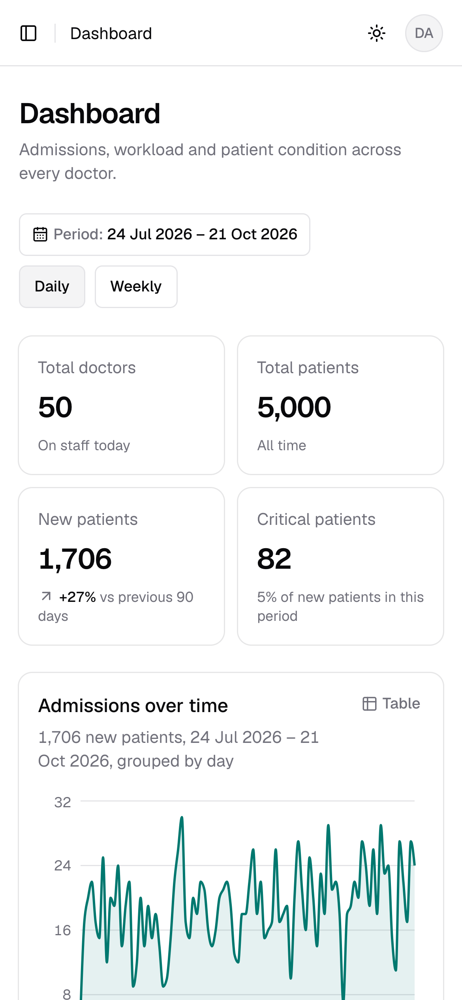 | 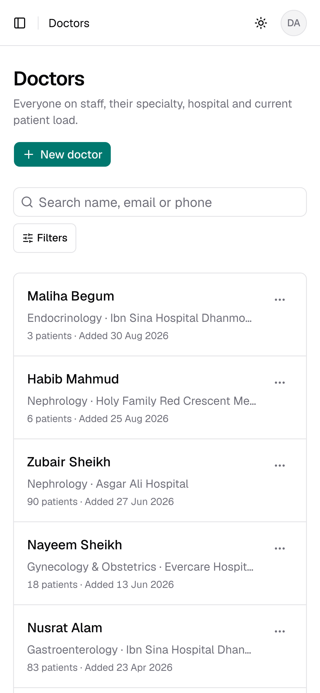 | 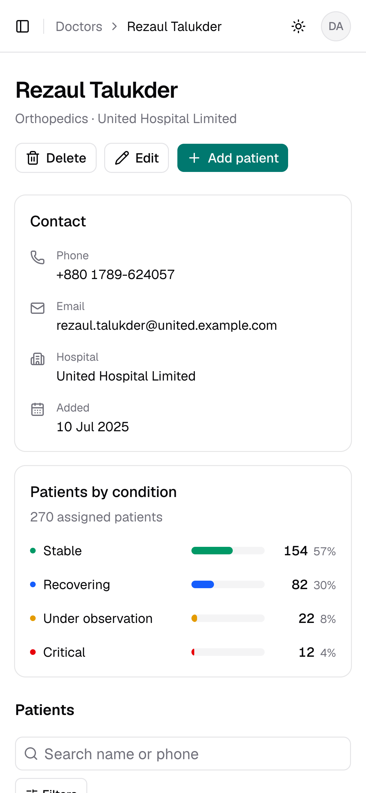 | 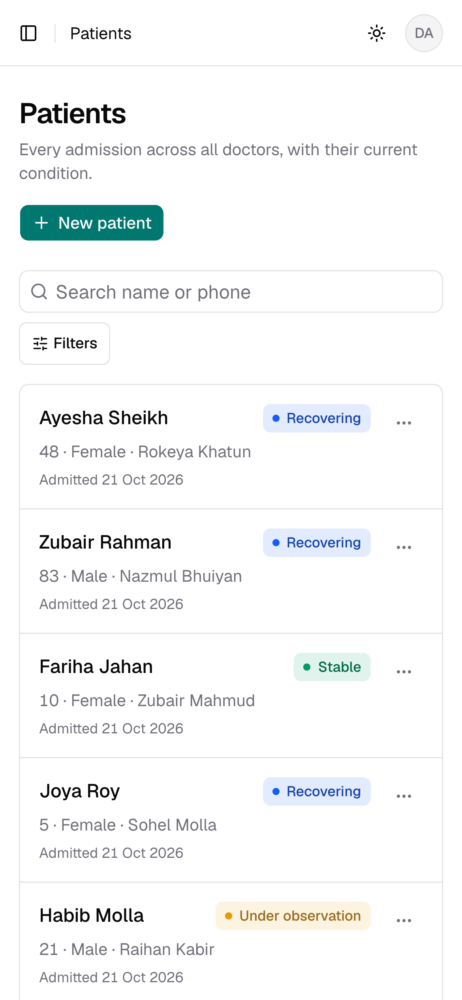 | 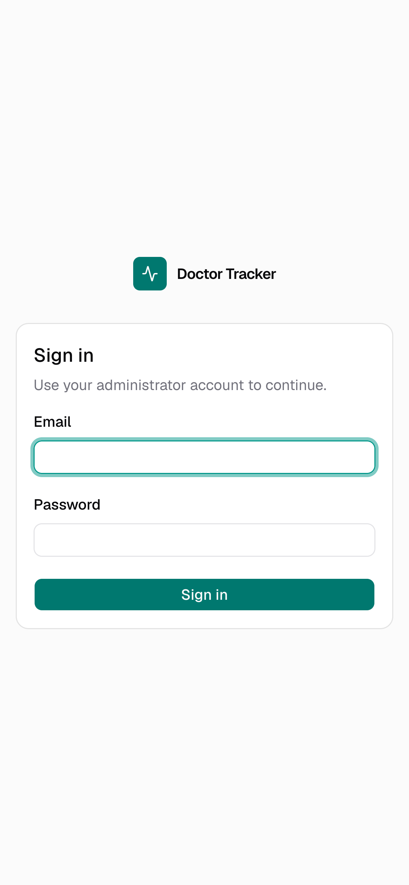 |

A few UI choices that aren't visible in a still image:

- **URLs are views.** Every filter, search, sort and page lives in the URL, so a view survives refresh and can be shared.
- **Search waits for you to stop typing** (300 ms debounce), so it doesn't send a request per keystroke.
- **Responsive refetches.** A refetch keeps the previous rows on screen, dimmed, instead of flashing skeletons. Deleting a patient removes the row immediately and restores it if the server refuses.
- **The condition palette was validated, not eyeballed.** Its four colors went through a colour-vision check in both themes. The amber was re-stepped because it was too close to red. Every condition is always shown with its text label, and every chart has a table view.

## What I'd do next

- **Server-side prefetch.** Prefetch the first page of each list in a server component and hydrate TanStack Query, so the first paint has data instead of a skeleton. That means forwarding the session cookie server to server and handling an expired access token there.
- **Patient detail and history.** Track condition changes as events (`stable → critical` with a timestamp and author) instead of overwriting the current condition, so the dashboard can show transitions, not just the latest state.
- **Roles beyond admin.** `requireRole` already takes a list. A read-only `viewer` role and per-hospital scoping would be the next steps.
- **Audit log.** Who changed which patient, and when. In a clinical tool this matters more than most features here.
- **Production hardening:**
  - Redis for rate limits and a revocation set for access tokens
  - keyset pagination
  - Atlas Search
  - indexes built in a migration step instead of Mongoose's `autoIndex`
  - a replica set, so deleting a doctor and reassigning their patients can be one transaction
- **End-to-end tests.** Playwright already drives the app for screenshots. Turning the main flows (sign in, filter, create, delete) into CI tests is a small step from there.
